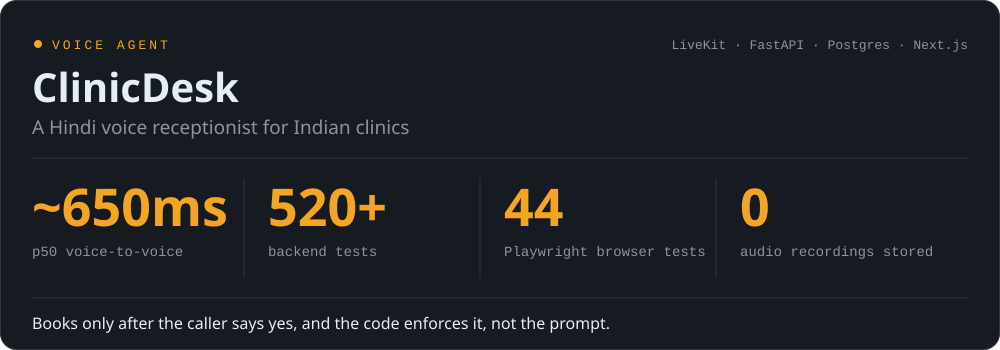
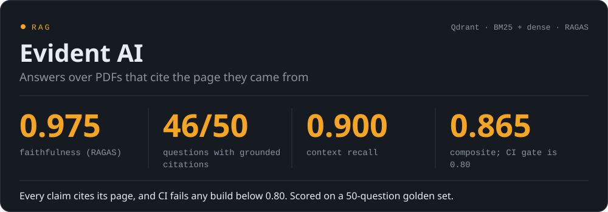
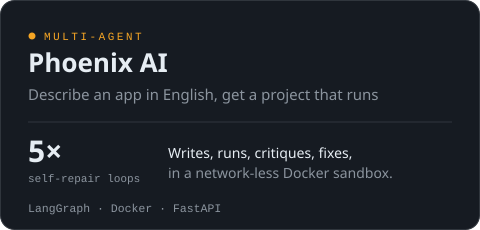
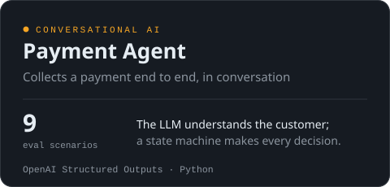

 

Most AI demos stop at a good answer. My work starts there: making agents
retrieve the right evidence, wait for a yes before they act, and fail loudly
instead of quietly. The rules that matter live in code, and every number
below comes from a real evaluation run.

 

<b>Now:</b> taking ClinicDesk from the browser to real phone lines, and to a first clinic pilot. 
Also on the bench: [ApplyTrack AI](https://github.com/Harsh251005/applytrack-ai) · [Tabula AI](https://github.com/Harsh251005/Tabula-AI) · [TruthLens AI](https://github.com/Harsh251005/TruthLens-AI) · [InsightForge](https://github.com/Harsh251005/InsightForge) · [DSA, one day at a time](https://github.com/Harsh251005/data-structures-and-algorithms)

 

  <a href="https://www.linkedin.com/in/harsh-dharnidharka/">LinkedIn</a> ·
  <a href="mailto:dharnidharkaharsh@gmail.com">dharnidharkaharsh@gmail.com</a> 
  BSc IT, University of Mumbai · National karate gold medallist · Open to Applied AI roles at early-stage startups

